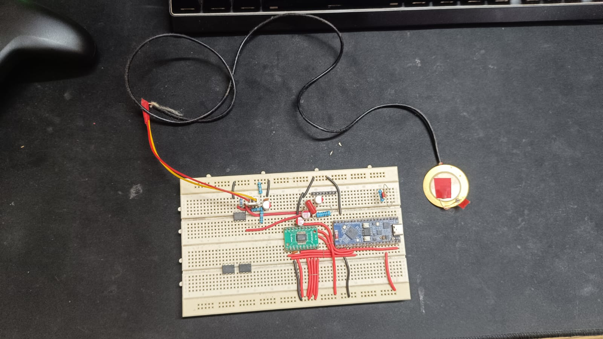

# PCGKolect
(test firmware)
*Collecting heartbeats, one sample at a time.* ❤️🩺

PCGKolect is an open-source firmware project for collecting high-quality heart sound recordings using a custom electronic stethoscope platform.

The system is built around an **ESP32-S3** and a **PCM1803A audio ADC**, with a custom analog front-end designed for heart sound acquisition. A **piezoelectric sensor** is used as the primary sensing element to capture acoustic vibrations from the chest wall, which are then amplified, digitized, and streamed to a host computer for recording and analysis.

The primary goal of PCGKolect is to provide an affordable and reproducible platform for:

* Heart sound dataset collection
* Electronic stethoscope research
* Biomedical signal processing
* Machine learning and AI applications involving PCG signals

---

## Current Development Status

🚧 **Early Development Phase**

The hardware, firmware, and data collection pipeline are currently under active development and experimentation.



---

## Hardware Overview

* ESP32-S3 microcontroller
* PCM1803A stereo audio ADC
* Custom analog signal conditioning front-end
* Piezoelectric sensor for heart sound acquisition
* USB audio streaming interface

---

## Building

### Requirements

* ESP-IDF
* ESP32-S3 toolchain
* Python

### Build

```bash
idf.py build
```

### Flash

```bash
idf.py flash
```

### Monitor

```bash
idf.py monitor
```

---

## License

MIT License
